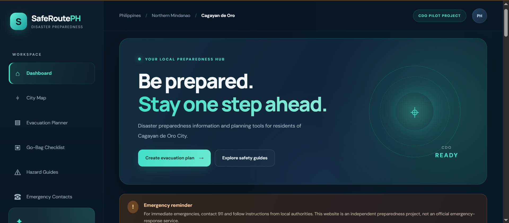
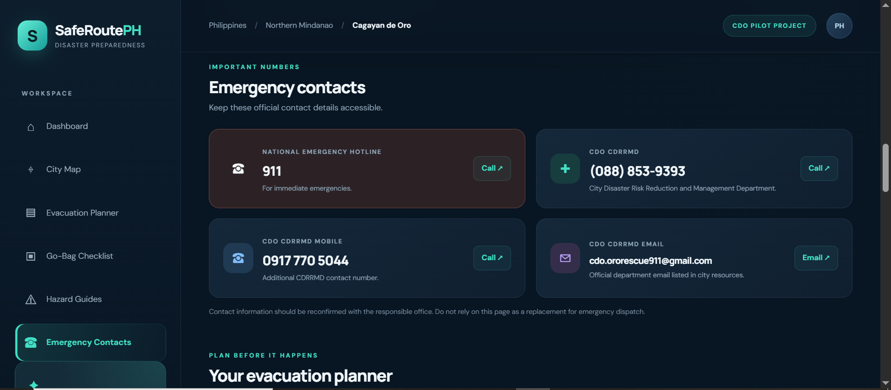
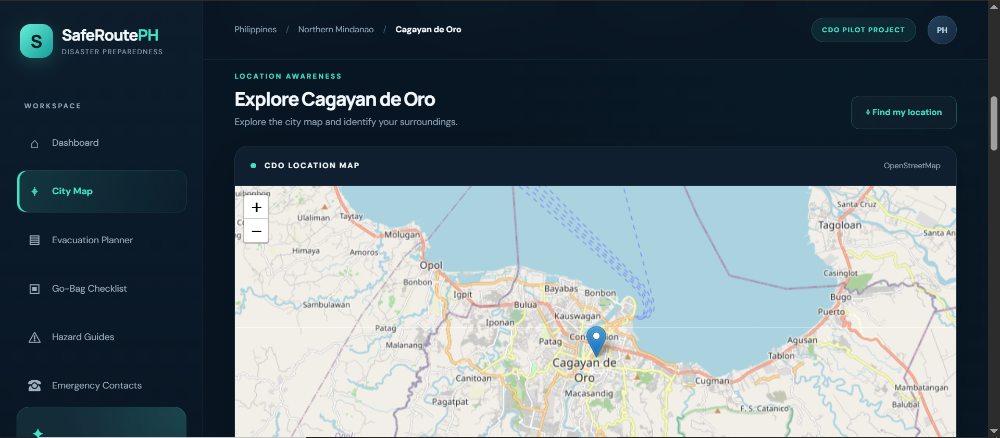
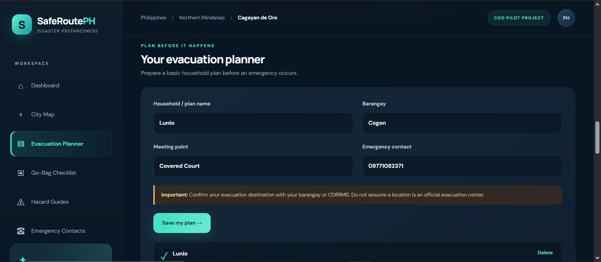
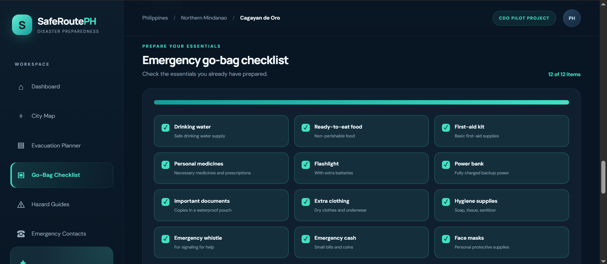
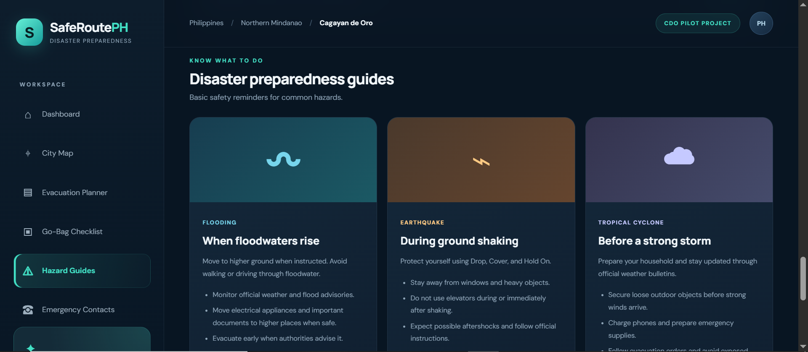

# 🌏 SafeRoute PH — Disaster Preparedness and Monitoring Platform


A **web-based disaster preparedness and information platform** designed to help individuals and households access emergency resources, organize evacuation plans, and prepare for potential disasters.

SafeRoute PH is initially focused on **Cagayan de Oro City, Misamis Oriental, Philippines**, bringing essential disaster preparedness tools and official information sources together in one accessible dashboard.

---

# 🖥️ Application Preview

<table>
  <tr>
    <td align="center">
      
      <br>
      <b>Main Dashboard</b>
    </td>
    <td align="center">
      
      <br>
      <b>Disaster Monitoring Center</b>
    </td>
  </tr>
  <tr>
    <td align="center">
      
      <br>
      <b>Interactive City Map</b>
    </td>
    <td align="center">
      
      <br>
      <b>Household Evacuation Planner</b>
    </td>
  </tr>
  <tr>
    <td align="center">
      
      <br>
      <b>Emergency Go-Bag Checklist</b>
    </td>
    <td align="center">
      
      <br>
      <b>Disaster Preparedness Guides</b>
    </td>
  </tr>
</table>

---

# 📌 Overview

Disasters can happen unexpectedly. Access to reliable information, proper preparation, and awareness of available emergency resources can help individuals and communities respond more effectively.

SafeRoute PH is an independent disaster preparedness platform that provides a centralized dashboard for accessing essential emergency information and preparedness tools.

The application combines interactive mapping, household evacuation planning, emergency contact information, go-bag preparation, hazard awareness guides, and links to official disaster monitoring agencies.

The platform is designed primarily for individuals, households, students, and communities interested in improving their disaster preparedness.

**Initial Pilot Location:** Cagayan de Oro City, Misamis Oriental, Philippines.

---

# ✨ Features

- 🌏 **Interactive City Map** — Explore Cagayan de Oro City through an interactive map powered by Leaflet.js and OpenStreetMap.
- 📍 **Current Location Detection** — Use browser-based geolocation to display the user's approximate current position on the map, with permission.
- 📡 **Live Disaster Monitoring Center** — Access official monitoring resources from PAGASA, PHIVOLCS, and CDO CDRRMD.
- 🌧️ **Weather Monitoring Resources** — Access official weather advisories, tropical cyclone bulletins, and rainfall information through PAGASA.
- 🌊 **Flood Monitoring Resources** — Access Cagayan de Oro River Basin monitoring information.
- 🌎 **Earthquake Information** — Access official earthquake reports and seismic information from PHIVOLCS.
- 🚨 **Emergency Contacts** — View important emergency contact information and available local response resources.
- 🏠 **Household Evacuation Planner** — Organize household details, barangay information, meeting points, and emergency contacts.
- 🎒 **Emergency Go-Bag Checklist** — Track essential emergency supplies and monitor preparation progress.
- 🌪️ **Disaster Preparedness Guides** — Explore basic preparedness information for floods, earthquakes, and tropical cyclones.
- 💾 **Local Data Storage** — Save evacuation plans and checklist progress directly in the browser using localStorage.
- 🔗 **Official Resource Links** — Access government and disaster-related information platforms.
- 📱 **Responsive Dashboard** — Designed to accommodate desktop, tablet, and mobile screens.
- 🌙 **Modern Dark-Themed Interface** — A clean interface featuring deep navy backgrounds, teal accents, and organized dashboard components.

---

# 🛠️ Technologies Used

## Programming Languages

- HTML5
- CSS3
- JavaScript

## Mapping and Geographic Services

- Leaflet.js
- OpenStreetMap
- Browser Geolocation API

## Browser Storage

- Web Storage API (localStorage)

## Development Tools

- Visual Studio Code
- Live Server
- Git
- GitHub
- Web Browser

## Deployment

- GitHub Pages

---

# 🚀 Installation and Setup

Follow these instructions to install and run SafeRoute PH locally.

## 1. Clone the Repository

Replace `your-username` with your GitHub username.

```bash
git clone https://github.com/your-username/SafeRoutePH.git
```

## 2. Navigate to the Project Folder

```bash
cd SafeRoutePH
```

## 3. Open the Project in Visual Studio Code

```bash
code .
```

Alternatively, open Visual Studio Code manually and select the SafeRoute PH project folder.

## 4. Run the Application Locally

SafeRoute PH is built using HTML, CSS, and JavaScript, so it does not require Node.js or npm for its current implementation.

Recommended method:

1. Open Visual Studio Code.
2. Install the **Live Server** extension if it is not already installed.
3. Open `index.html`.
4. Right-click inside the editor.
5. Select **Open with Live Server**.

The application will open in your browser, usually at:

```text
http://127.0.0.1:5500/
```

You can also use another local static web server if preferred.

**Note:** An internet connection is required for external map tiles and official external resources. Browser geolocation generally requires localhost or a secure HTTPS connection.

---

# 📖 How to Use SafeRoute PH

## 1. Main Dashboard

The main dashboard provides access to the platform's primary features and preparedness resources.

Users can navigate between the interactive map, emergency contacts, evacuation planner, go-bag checklist, monitoring center, and hazard guides.

## 2. Interactive City Map

The interactive map provides a geographic reference for Cagayan de Oro City.

1. Open the City Map section.
2. Explore the map using zoom and drag controls.
3. Select the location button to request your current browser location.
4. Allow location permission when prompted.
5. View your detected position on the map.

The city-center marker is an approximate orientation point. It is not an evacuation center, designated safe zone, or verified evacuation destination.

## 3. Disaster Monitoring Center

The monitoring center provides links to official disaster information sources.

Available resources include:

- **PAGASA:** Weather information and official advisories.
- **PAGASA Cagayan de Oro River Basin:** Flood-related monitoring resources.
- **PHIVOLCS:** Earthquake and seismic information.
- **CDO CDRRMD:** Local disaster preparedness and emergency information.

Users should open the official sources to review their latest published information.

The current implementation is an official-source information hub. It does not independently retrieve or verify live sensor readings, emergency alerts, or evacuation orders.

## 4. Emergency Contacts

The Emergency Contacts section provides important contact information for emergency-related assistance.

Users can review available contact details and use their device's communication applications when applicable.

Always verify contact information and follow instructions from authorized emergency responders.

## 5. Household Evacuation Planner

The evacuation planner helps households organize essential emergency planning information.

1. Open the Evacuation Planner section.
2. Enter your household name or identifier.
3. Provide your barangay.
4. Enter your family's agreed meeting point.
5. Add an emergency contact.
6. Save your plan.

The saved information is stored locally in the browser.

Confirm evacuation destinations and routes with local authorities. The planner does not automatically identify safe evacuation centers or calculate verified evacuation routes.

## 6. Emergency Go-Bag Checklist

The go-bag checklist helps users track essential emergency supplies.

1. Open the Go-Bag Checklist section.
2. Review the listed emergency supplies.
3. Check the items that are already prepared.
4. Monitor your preparation progress.
5. Reset the checklist when necessary.

Checklist progress is saved in the browser using localStorage.

## 7. Disaster Preparedness Guides

The Hazard Guides section provides introductory preparedness information for:

- Floods
- Earthquakes
- Tropical Cyclones

Users can review basic preparedness reminders and access relevant official information sources.

---

# 🌐 Official Information Sources

SafeRoute PH references the following external resources:

| Organization / Resource       | Purpose                               | Official Website                                                                                           |
| ----------------------------- | ------------------------------------- | ---------------------------------------------------------------------------------------------------------- |
| PAGASA                        | Weather forecasts and advisories      | [https://www.pagasa.dost.gov.ph/](https://www.pagasa.dost.gov.ph/)                                         |
| PAGASA CDO River Basin        | Cagayan de Oro flood monitoring       | [https://www.pagasa.dost.gov.ph/flood/cagayan-de-oro](https://www.pagasa.dost.gov.ph/flood/cagayan-de-oro) |
| PHIVOLCS                      | Earthquake and seismic information    | [https://www.phivolcs.dost.gov.ph/](https://www.phivolcs.dost.gov.ph/)                                     |
| CDO CDRRMD                    | Local disaster management information | [https://cdrrmd.cagayandeoro.gov.ph/](https://cdrrmd.cagayandeoro.gov.ph/)                                 |
| HazardHunterPH                | Hazard assessment resources           | [https://hazardhunter.georisk.gov.ph/map](https://hazardhunter.georisk.gov.ph/map)                         |
| Philippine Emergency Hotlines | Emergency contact directory           | [https://ehotlines.e.gov.ph/](https://ehotlines.e.gov.ph/)                                                 |
| OpenStreetMap                 | Interactive map data                  | [https://www.openstreetmap.org/](https://www.openstreetmap.org/)                                           |

---

# ⚙️ Core Modules

- **Dashboard Module:** Displays the main navigation, preparedness information, and application overview.
- **Interactive Mapping Module:** Handles map initialization, geographic navigation, and optional browser geolocation.
- **Disaster Monitoring Module:** Provides access to official weather, flood, earthquake, and local disaster information sources.
- **Emergency Contact Module:** Displays important emergency contact details.
- **Evacuation Planner Module:** Collects and saves household evacuation planning information.
- **Go-Bag Checklist Module:** Tracks emergency supply preparation and calculates checklist completion.
- **Hazard Guide Module:** Provides introductory disaster preparedness information.
- **Local Storage Module:** Handles saving and retrieving household plans and checklist progress from browser storage.

---

# 📂 Project Structure

```text
SafeRoutePH/
│
├── index.html
├── styles.css
├── app.js
│
├── README.md
├── CONTRIBUTING.md
├── DATA_SOURCES.md
├── LICENSE
├── .gitignore
│
└── images/
    ├── Dashboard.PNG
    ├── Emergency-Contacts.PNG
    ├── City-Map.PNG
    ├── Evacuation-Planner.PNG
    ├── Go-Bag-Checklist.PNG
    └── Hazard-Guides.PNG
```

### File Descriptions

| File              | Purpose                                                                                                |
| ----------------- | ------------------------------------------------------------------------------------------------------ |
| `index.html`      | Main HTML structure and dashboard sections.                                                            |
| `styles.css`      | Application styling, layout, animations, and responsive design.                                        |
| `app.js`          | Handles map initialization, navigation, geolocation, evacuation planning, and checklist functionality. |
| `README.md`       | Project overview, features, installation instructions, and documentation.                              |
| `CONTRIBUTING.md` | Guidelines for contributing to the project.                                                            |
| `DATA_SOURCES.md` | Documents official information sources and data verification guidelines.                               |
| `LICENSE`         | Contains the project's MIT License.                                                                    |
| `.gitignore`      | Lists files and folders excluded from Git tracking.                                                    |
| `images/`         | Stores application screenshots used in project documentation.                                          |

---

# ⚠️ Limitations and Important Notes

SafeRoute PH is an independent disaster preparedness prototype. It is not an official government application or emergency-response service.

The following limitations currently apply:

- The initial project focuses on Cagayan de Oro City.
- The disaster monitoring center provides external official-source links rather than automatically retrieving live monitoring data.
- No independently verified real-time flood sensor readings are currently integrated.
- No automatic earthquake alert or weather notification system is currently implemented.
- The map's city-center marker is for geographic orientation only.
- Verified evacuation centers and safe routes are not currently provided by the application.
- Browser geolocation requires user permission and a supported browser.
- Household plans and checklist progress are stored locally and are not synchronized across devices.
- Browser localStorage is not encrypted or backed up by the application. Avoid entering sensitive personal information.
- External services require internet access and may be unavailable or change their interfaces.

**Emergency Reminder:** Always follow official announcements and instructions from PAGASA, PHIVOLCS, CDO CDRRMD, barangay authorities, and authorized emergency responders.

---

# 🔮 Future Improvements

Possible future enhancements include:

- Automatic integration of official PAGASA weather information.
- Recent earthquake information integration from PHIVOLCS.
- Available Cagayan de Oro River Basin observation integration.
- Verified local disaster announcements and alert history.
- Last-updated timestamps for external information.
- Interactive map layers for verified hazard and evacuation information.
- Officially verified evacuation center directory.
- Improved household evacuation planning.
- Printable and downloadable emergency plans.
- Emergency preparedness notifications.
- Additional disaster preparedness guides.
- Expanded geographic coverage to other Philippine cities.
- Improved accessibility and multilingual support.
- Optional backend services for reliable data integration.

These are proposed improvements and are not necessarily available in the current version.

---

# 👨‍💻 Developer

**Rheil Evans T. Lunio**

Computer Science Student
University of Science and Technology of Southern Philippines (USTP)

GitHub: [https://github.com/rheillunio2-byte](https://github.com/rheillunio2-byte)

---

# 🤝 Contributing

Contributions, suggestions, bug reports, documentation updates, and feature improvements are welcome.

Please read [CONTRIBUTING.md](CONTRIBUTING.md) for guidelines on how to contribute to SafeRoute PH.

---

# 📄 License

This project is licensed under the **MIT License**. See the [LICENSE](https://github.com/rheillunio2-byte/SafeRoutePH?tab=MIT-1-ov-file) file for more details.

---

**SafeRoute PH — Prepare Today. Respond Better Tomorrow.**
